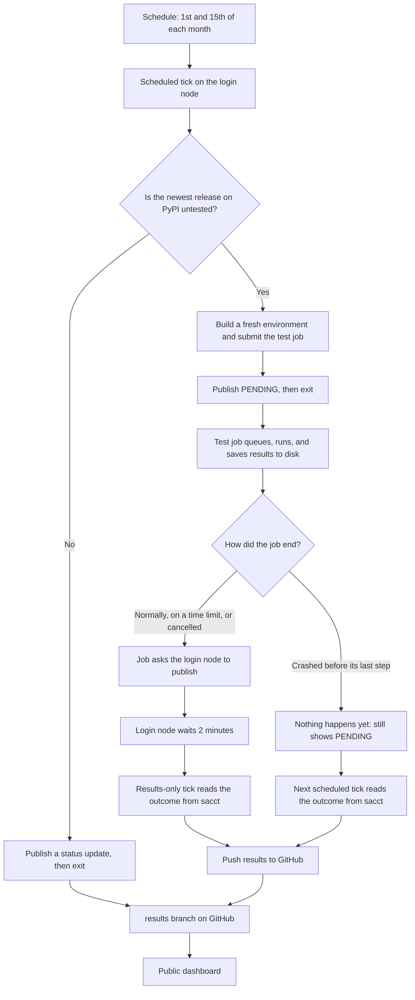
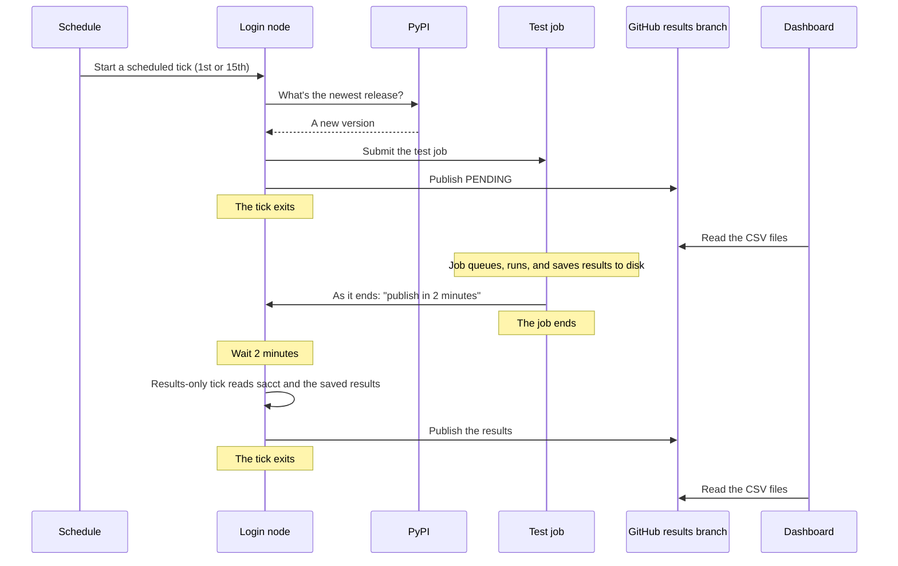

# How it works

Twice a month, the monitor wakes up and asks PyPI whether RHAPSODY has a new release. If it does, the monitor submits a test job. When that job ends, its results are published to GitHub, and the public dashboard reads them from there.

Most of the time there's no new release, so the monitor exits within seconds.

For why it's built this way, see [ARCHITECTURE.md](ARCHITECTURE.md).

## Terminology

| Term | Meaning |
|---|---|
| **Tick** | One short run of the monitor. It does its to-do list, then exits. Nothing keeps running between ticks. |
| **Scheduled tick** | The tick that runs on the 1st and 15th of each month. It's the only kind that checks for releases. |
| **Results-only tick** | One extra tick about 2 minutes after a test job ends. It publishes that job's results, and never starts a job. |
| **Release check** | One item on a scheduled tick's list: "Is the newest release on PyPI untested?" |
| **Test job** | The real SLURM job that runs the test suite. It uses 2 nodes for up to 35 minutes, and only starts when a release check finds something new. |
| **Run** | One `[[run]]` entry in a machine's `site.toml`: which job script to submit, and which tests to select. Most machines have one. |
| **Suite** | A run's label on the dashboard, such as `CPU` or `GPU`. Empty on a machine with one run. |
| **CPU and GPU split** | A machine with two runs: one job for tests without `@pytest.mark.gpu`, and one for tests with it. CPU testing then continues when GPU hours run out. |
| **Switched-off run** | A run with `enabled = false`. Release checks skip it. When switched on again, it records the current release without running it, so it starts with the next new release. |
| **Schedule** | The `scrontab` entry that starts scheduled ticks. On Stellar AI, `crontab` isn't allowed, so this is how ticks get started. |
| **`scrontab` job** | The very short SLURM job the schedule starts. On Stellar AI, it only connects to the login node, where the tick runs. It sits in `squeue` as `hpc-grafana-tick`, usually `PENDING` while it waits for its next time. This is normal. |
| **`sacct`** | SLURM's record of what happened to a job, including jobs it killed. The monitor trusts this for how a job ended. |
| **Baseline** | The first test run on a newly connected machine, started by hand. The first time a machine sees a release, it only records it, so nothing spends allocation by surprise. |
| **Publish** | Commit results and push them to the `results` branch on GitHub. |
| **`results` branch** | The branch holding the published CSV files and logs. It holds no code. |
| **Dashboard** | The public Grafana page. It only reads the CSV files on GitHub, so it shows what was last published, not a live view of SLURM. |
| **Deploy key** | The SSH key that lets a machine push to this repo. Each machine has its own. |

### Dashboard statuses

| Status | Meaning |
|---|---|
| `PENDING` | The job was submitted, and no result has been published yet. **It can be queued, running, or dead,** because nothing publishes while a job runs. |
| `RUNNING` | A tick happened to run while the job was running. This is rare. |
| `PASSED` | The job finished and every test that ran passed. |
| `FAILED` | A test failed, the job couldn't start, or SLURM killed it. The reason is shown. |

## The flow



## The sequence

This is a release being found and tested on Stellar AI:



## How often things happen

For one connected machine:

| What | Per week | Per month | When |
|---|---|---|---|
| Scheduled ticks | About 0.5 | 2 | 06:00 on the 1st and 15th |
| `scrontab` jobs | About 0.5 | 2 | One per scheduled tick, lasting seconds |
| Release checks | About 0.5 | 2 | One per scheduled tick |
| Test jobs | 0 to 0.5 | 0 to 2 | Only when a check finds a new release; one per switched-on run |
| Results-only ticks | 0 to 0.5 | 0 to 2 | One per test job, about 2 minutes after it ends |

The numbers above are for one run. A machine with CPU and GPU runs both switched on has twice the test jobs and results-only ticks, but the same scheduled ticks.

- The gap between scheduled ticks is 13 to 17 days, because schedules use calendar dates.
- A new release waits for the next scheduled tick. If two releases appear between ticks, only the newest gets tested.
- If you run `tick` or `run` by hand, those are extra.

## When a job dies

A job normally reports when it ends, even if it hits its time limit or is cancelled. A sudden crash can stop it from doing that:

1. **Dec 1, 06:00:** a scheduled tick finds release 0.7.0, submits the job, publishes `PENDING`, and exits.
2. **Dec 1, 09:00:** the job starts.
3. **Dec 1, 09:20:** a node fails. The job ends immediately, so it can't ask for its results to be published.
4. **Dec 1 to Dec 15:** the dashboard still shows `PENDING`, with a submitted date of Dec 1.
5. **Dec 15, 06:00:** the next scheduled tick reads `NODE_FAIL` from `sacct`. The dashboard turns red, and shows results from the test files that finished.

## If a run is stuck on `PENDING`

Compare the status with the run's **submitted** date on the dashboard:

| How long it's been `PENDING` | What it probably means |
|---|---|
| Less than a day or two | Normal. It's probably still in the queue or running. |
| Several days | Worth a look. The queue may be long, or the job may have died. |
| Past the next scheduled tick | Something's wrong. That tick should have updated it, so the schedule or publishing may have stopped. |

This takes a person to investigate. On the machine, from the clone:

```bash
# 1. Is the job still queued or running? "squeue" also gives the reason it's waiting.
squeue -u $USER

# 2. What does SLURM say happened? Use the job number from the dashboard.
sacct -j <job> --format=JobID,State,ExitCode,Elapsed,Start,End,Reason

# 3. Update the dashboard now. This doesn't start a test job.
python3 hpc_monitor.py tick --results-only --site sites/<machine>/site.toml

# 4. If it's still unclear, read the monitor's log and the job's output.
tail -20 ~/.hpc-monitor-grafana/<machine>/monitor.log
ls ~/.hpc-monitor-grafana/<machine>/runs/
```

| What you find | Likely cause | What to do |
|---|---|---|
| Still in `squeue`, `PENDING` | Long queue | Wait, and check the reason `squeue` gives |
| Reason mentions a limit or allocation | No allocation left, or a QOS limit | Sort out the allocation, or cancel it and rerun later |
| `sacct` says `NODE_FAIL`, `OUT_OF_MEMORY`, `TIMEOUT`, or `CANCELLED` | The job died or was killed | Step 3 publishes it as `FAILED`, then rerun with `run --version` if needed |
| `sacct` says `COMPLETED`, and it wasn't published | The end-of-job step or push failed | Step 3 publishes it. Check `monitor.log` for why |
| Nothing has updated in `monitor.log` for over 17 days | The schedule stopped | Check `scrontab -l` |

"Last report" on the dashboard can also help. It updates at every tick, so over about 17 days old means the machine has stopped reporting.
